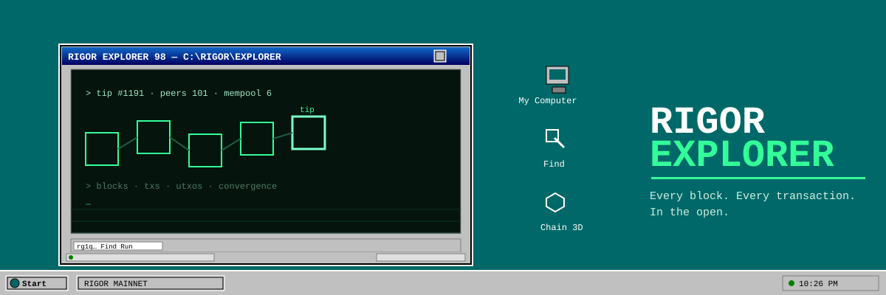

<div align="center">



# RIGOR EXPLORER 98

**Every block. Every transaction. In the open — on a desktop from 1995.**

A full explorer for the [RIGOR](https://www.rigorchain.com/) mainnet, rebuilt as a retro operating system:
boot screen, teal desktop, draggable windows, taskbar, 3D chain visualizer — with the
information architecture of a serious modern explorer underneath.

[](https://rigor-explorer.pages.dev)
[](LICENSE)

[](https://react.dev)
[](https://vitejs.dev)
[](https://threejs.org)
[](https://www.rust-lang.org)
[](https://webassembly.org)
[](https://workers.cloudflare.com)

[Live site](https://rigor-explorer.pages.dev) · [Rust API health](https://rigor-explorer-api.arechampionw.workers.dev/health) · [Official explorer](https://explorer.rigorchain.com) · [RIGOR source](https://github.com/rigorchain/rigorchain)

</div>

---

## The story, in plain English

Every chain needs a window. The RIGOR website greets you with a BIOS boot and a teal desktop from another era — and this explorer takes that idea seriously: **it turns the chain into a small operating system.** You boot into it. You open `My Computer` and the network speaks. You drag windows, you look up an address in the Address Book, you watch the tip block pulse in 3D, and the taskbar LED goes green when the mainnet answers.

Under the retro skin is the explorer every chain deserves: live status, smart search, per-block detail, address flows, UTXOs, mining payouts, convergence activity — all read-only, all from the official public API, with **zero credentials** anywhere in the system.

> **What this is not:** not a wallet, not a pool dashboard, not affiliated with the RIGOR project. It never asks for keys and it cannot sign anything. It is a pane of glass onto the chain, styled like 1995.

---

## Features

| Window | What it shows |
| --- | --- |
| 🖥️ **My Computer** | Tip height, difficulty, estimated hashrate, peers, mempool, and the monetary state: ORU circulating, immature coinbase, convergence burns, fee burns, RES supply |
| 📦 **Blocks** | The last 100 blocks — age, time, tx count, ORU minted, convergence burn, RES minted — auto-refreshing every 30s |
| 📄 **Block detail** | Full header (hash, previous, bits, merkle root, Opus hash) + reward and consensus panels |
| ✉️ **Transaction** | Summary fields, coinbase flag, and the complete raw hex in a notepad-style terminal |
| 📇 **Address Book** | Balances, lifetime received/spent, UTXO list, transaction history, convergence activity (mints, winner/candidate roles), RES mints |
| ⛏️ **Mining payouts** | RIGOR has **no pools** — every 128 ORU block reward is a coinbase UTXO paid straight to the miner's own `rg1q…` address. The Address Book makes those payouts visible |
| 🔍 **Find** | One box, strict rules: a number opens a block, a 64-hex string resolves to a transaction or block hash, an `rg1q…` string opens the address |
| 📊 **Statistics** | Per-block transaction and convergence-burn charts, window summaries computed in Rust/WASM |
| 🧊 **Chain 3D** | The last 24 blocks as a rotating phosphor-green chain (Three.js). Drag to orbit. Click a cube to open that block |
| 🌐 **Network** | Chain identity, live node state, and the public API surface |

The taskbar tray polls the chain every 12 seconds: the LED is green when connected, red when the API is unreachable, and it shows the tip height next to the clock.

---

## The stack — Rust at both ends

```
┌──────────────────────────────────────────────────────────┐
│  the desktop                                             │
│  React 18 · Vite · Three.js   ──  windows, taskbar, 3D    │
│         │                                                │
│         ▼                                                │
│  explorer-core (Rust → WASM)                             │
│  query classification · 128-bit atom math · summaries    │
│  loaded at boot, JS fallback if WASM is unavailable       │
└────────────────────────┬─────────────────────────────────┘
                         │  HTTPS · read-only · CORS
                         ▼
┌──────────────────────────────────────────────────────────┐
│  rigor-explorer-api  (Rust → WASM, Cloudflare Worker)     │
│  proxy + edge cache + /api/resolve                        │
└────────────────────────┬─────────────────────────────────┘
                         │
                         ▼
┌──────────────────────────────────────────────────────────┐
│  explorer.rigorchain.com/api  (official public chain API)│
└──────────────────────────────────────────────────────────┘
```

| Layer | Technology | Role |
| --- | --- | --- |
| Frontend | React 18, Vite 5, Three.js | Desktop shell, window manager, every data window, the 3D chain |
| Core | Rust → WebAssembly (`core/`) | Query classification, exact `u128` atom→ORU math (no floats near money), window summaries |
| Backend | Rust → WebAssembly on Cloudflare Workers (`worker/`) | Read-only proxy of the public chain API with CORS and caching, plus server-side search resolution |
| Hosting | Cloudflare Pages + Workers | Static frontend at `*.pages.dev`, Rust backend at `*.workers.dev` |

---

## Build and deploy

```bash
# Frontend
cd web && npm install && npm run build
npx wrangler pages deploy dist --project-name=rigor-explorer

# Backend worker (Rust)
cd worker
cargo build --lib --release --target wasm32-unknown-unknown
wasm-bindgen target/wasm32-unknown-unknown/release/rigor_explorer_api.wasm \
  --out-dir generated --target bundler
npx wrangler deploy

# Frontend core (Rust → WASM)
cd core
cargo build --release --target wasm32-unknown-unknown
wasm-bindgen target/wasm32-unknown-unknown/release/explorer_core.wasm \
  --out-dir ../web/src/wasm --target web
```

The worker's generated bindings are committed, so deploying the backend does not require a Rust toolchain. Rebuild them after changing `worker/src/lib.rs`.

Local development:

```bash
cd web && npm run dev          # Vite dev server on :5173
cd worker && npx wrangler dev  # Rust API on :8787
```

---

## Security: no credentials, anywhere

- The upstream chain API is **public and read-only**; the Rust worker adds CORS and caching, nothing else
- **No API keys, tokens or secrets exist** in this repository, the worker, or the client bundle
- `.gitignore` blocks every `.env*` file by pattern
- The explorer never asks for keys, cannot sign, cannot relay, cannot custody — end to end read-only

---

## Repository layout

```
web/                 React + Vite + Three.js frontend
  src/App.jsx          desktop shell, window manager, taskbar
  src/Window.jsx       draggable beveled window chrome
  src/ChainScene.jsx   Three.js 3D block chain
  src/pages/           data windows (Overview, Blocks, Block, Tx, Address, Search, Stats, Network)
  src/api.js           API client + Rust/WASM core loader
core/               Rust crate → WASM (classification, atom math, summaries)
worker/             Rust crate → Cloudflare Worker (API proxy + /api/resolve)
docs/banner.svg     the banner you see above
```

---

## Disclaimer

Independent community tooling. **Not affiliated with, endorsed by, or operated by the RIGOR project.**
Data comes from the public chain API and may lag the chain tip by a few seconds.
Nothing here is financial advice; ORU and RES are experimental assets on a young network.

## License

[MIT](LICENSE) — use it, fork it, ship your own desktop.
